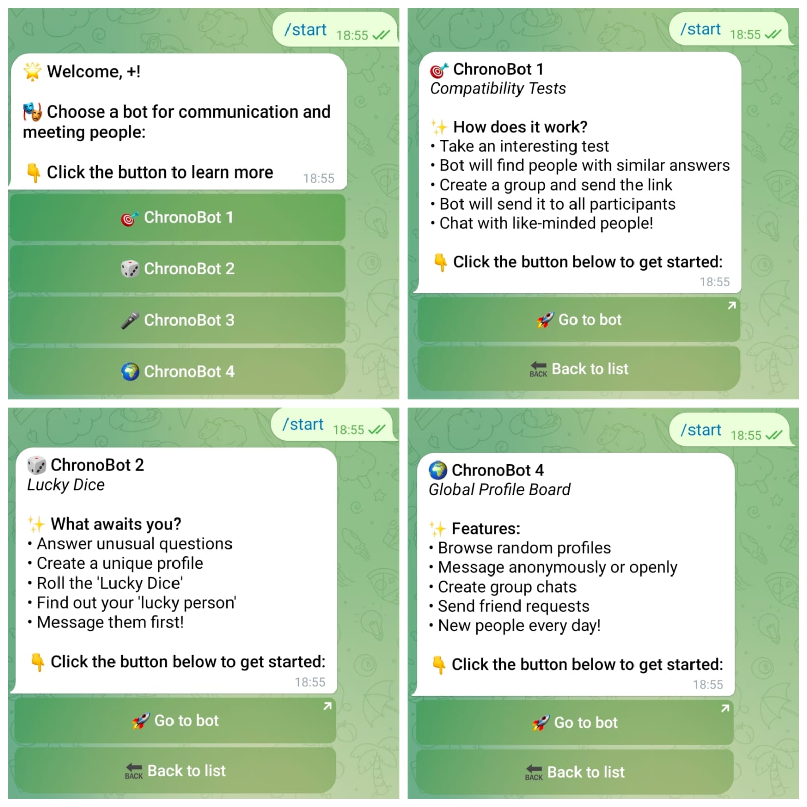

# ChronoRoom — Bot Launcher

A central Telegram bot that provides access to the ChronoRoom bot ecosystem through a single interface.

## 📸 Demo



## ✨ Features

- 🎯 Centralized ChronoRoom menu
- 🤖 Access to four independent Telegram bots
- 📋 Information about each bot
- 🔗 Direct links to the selected bot
- 🔐 Telegram channel subscription check
- 📱 Inline Telegram interface
- 🆘 `/help` command

## 🤖 Available Bots

### ChronoBot 1

Compatibility tests and matchmaking based on user answers.

### ChronoBot 2

Profile creation, questionnaires, and random profile discovery.

### ChronoBot 3

Random voice conversations, voice effects, and a mini-game.

### ChronoBot 4

Profile discovery, anonymous communication, and group invitations.

## 🔄 How It Works

1. The user starts the launcher.
2. The bot checks that the user is subscribed to the channel.
3. The ChronoRoom menu is displayed.
4. The user selects one of the four bots.
5. Information about the selected bot is displayed.
6. The user can open the selected bot directly.

## 🔐 Subscription Check

The menu is available only to subscribers of the channel from `CHANNEL_USERNAME`.

- The check **fails closed**: if Telegram cannot confirm the membership (outage, timeout, wrong settings), nothing is shown. The user is told it is a temporary problem and gets a "Try again" button; they are **not** told that they are not subscribed.
- On startup the bot checks that it can read the members of the channel. If the channel is wrong or the bot is not an administrator there, it stops with an explanatory message instead of showing "not subscribed" to everybody.
- All texts are sent as HTML and the user's name is escaped, so unusual names cannot break the messages.

## 🧩 Project Structure

```text
ChronoRoom-Bot5/
├── README.md
├── .env.example
├── .gitignore
├── requirements.txt
├── screenshots/
│   └── demo.jpg
├── tests/
│   └── test_launcher.py
└── bot.py
```

| File | Purpose |
| --- | --- |
| `bot.py` | The whole launcher: configuration, subscription check, menus and handlers |
| `tests/` | Unit tests (standard library `unittest`) |

## 🛠 Tech Stack

- Python 3.10+
- python-telegram-bot 21+

## 📦 Installation

```bash
git clone <repository-url>
cd ChronoRoom-Bot5
python -m venv .venv
source .venv/bin/activate        # Windows: .venv\Scripts\activate
pip install -r requirements.txt
```

## ⚙️ Configuration

Settings are read from environment variables or from a local `.env` file (git-ignored). Copy the template and fill it in:

```bash
cp .env.example .env
```

| Variable | Required | Description |
| --- | --- | --- |
| `BOT_TOKEN` | yes | Bot token from [@BotFather](https://t.me/BotFather) |
| `CHANNEL_USERNAME` | yes | Channel users must subscribe to, for example `@YourChannel`. The bot must be an **administrator** of this channel, otherwise it cannot check subscriptions. |
| `CHANNEL_URL` | for private channels | Link for the "Subscribe" button. For a public channel it is derived from `CHANNEL_USERNAME`. |

The bots shown in the menu (names, descriptions and links) are defined in the `BOT_DESCRIPTIONS` dictionary at the top of `bot.py`; edit it to point to your own bots.

## 🚀 Running the Bot

```bash
python bot.py
```

## ✅ Tests

```bash
python -m unittest discover -s tests -v
```

The tests use fake objects and no network, but they need `python-telegram-bot`; without it they are skipped automatically.

## 📌 About

ChronoRoom-Bot5 is one of several independent Telegram bots created for the ChronoRoom project.
